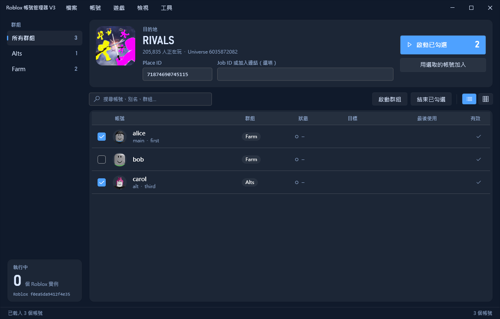
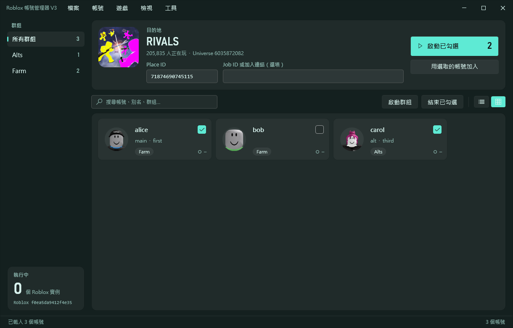
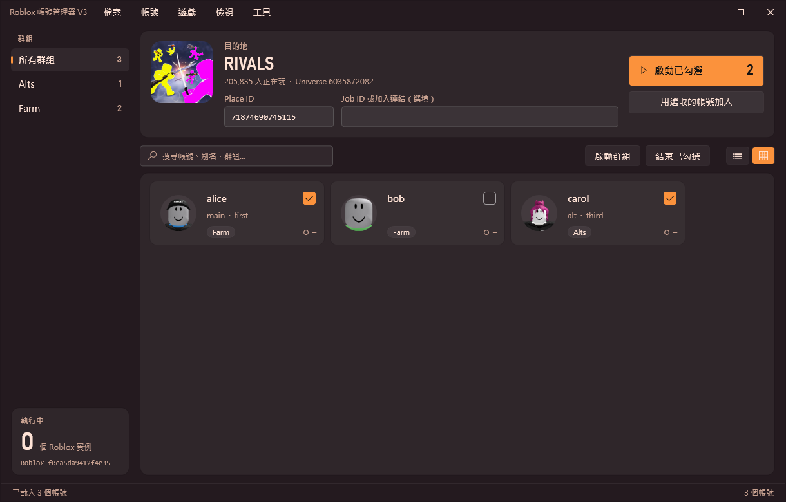
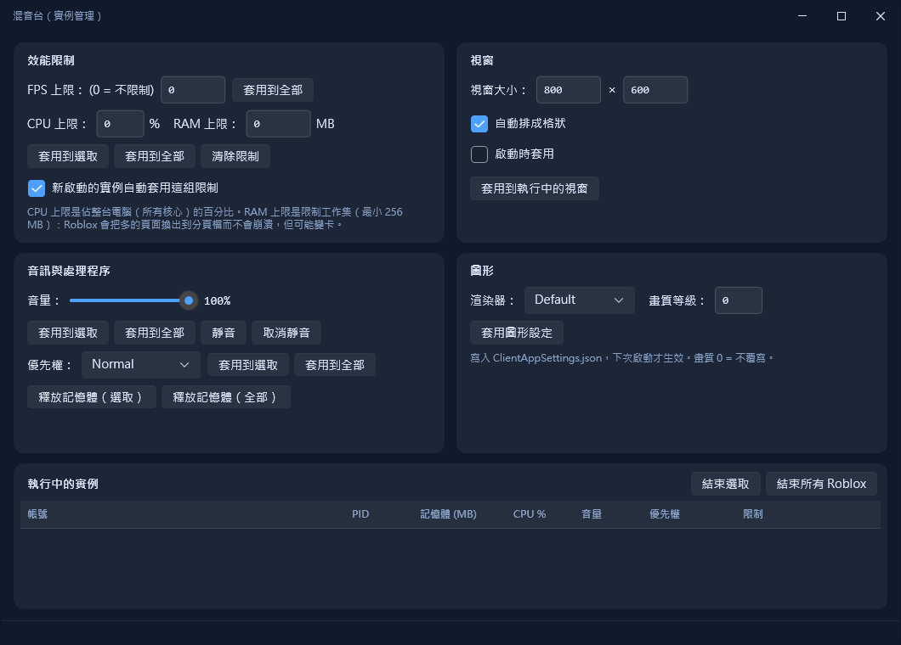
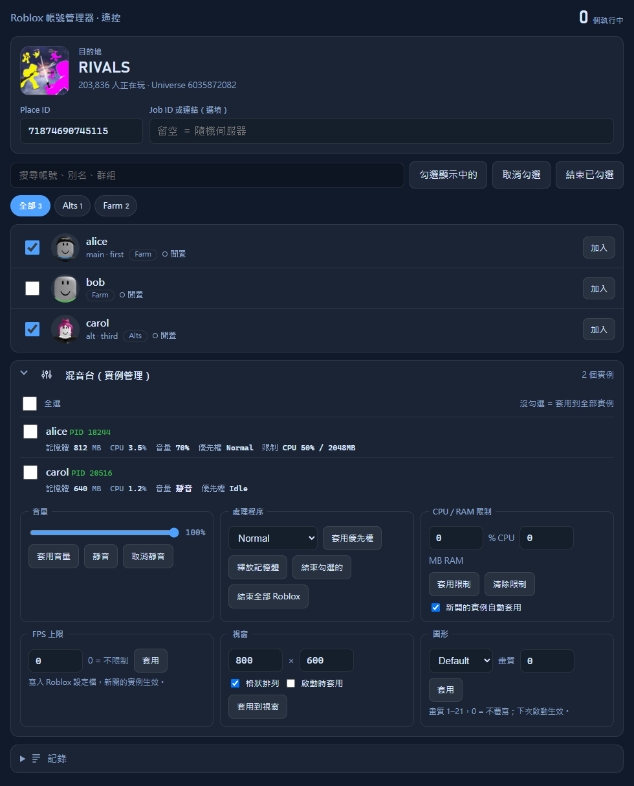
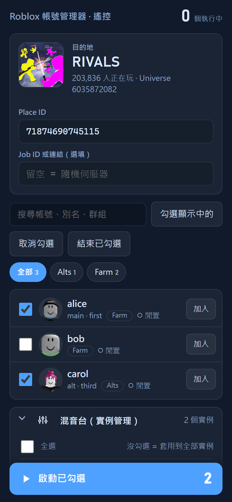
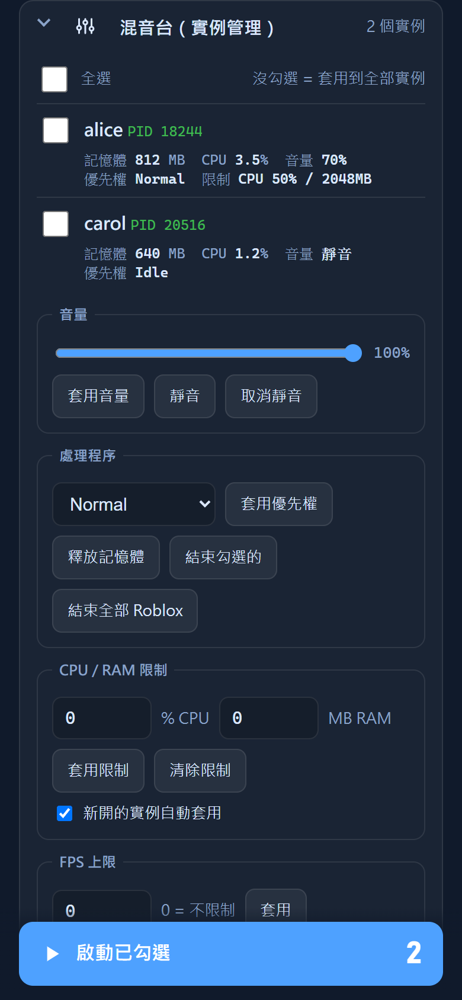

<div align="center">

# Roblox Account Manager V3

**多帳號、多開、混音台與手機遙控，一個 Windows 程式搞定**

C# · WPF（Fluent）· .NET 10 · 8 款主題 · 內建網頁控制面板



</div>

V2（Python）的 C# 重寫版，並把 MultiRoblox-RAM 的功能一併移植進來。目標框架 .NET 10、WPF（Fluent 主題）。

## 畫面

### 桌面版

| 磚塊版面（Aurora 主題） | 換個主題（Sunset） |
| :---: | :---: |
|  |  |

**混音台**：每個實例的記憶體、CPU、音量與優先權，以及 CPU / RAM 限制、視窗排列、FPS、渲染器與畫質。



### 網頁控制面板（手機也能用）

在桌面版「工具 → 開啟網頁控制面板」。配色跟著桌面主題；區網（手機）連線需設定密碼。

| 電腦瀏覽器 | 手機：帳號與目的地 | 手機：混音台 |
| :---: | :---: | :---: |
|  |  |  |

> 截圖中的帳號、頭像與混音台實例數據為示範用資料。

## 功能

### 帳號與啟動
- 帳號清單（清單 / 磚塊兩種版面）、群組、別名、描述、搜尋；**勾選要同時啟動的帳號 →「啟動已勾選」**（勾選狀態會保存）
- 登入新增帳號（內嵌 WebView2 登入）、在瀏覽器開啟帳號（自動帶入 cookie）、匯入 cookie / V2 JSON / **V2 與原版 RAM 的 Argon2 加密 `accounts.dat`**
- 加入伺服器：Place ID / Job ID（可貼整條加入連結，會自動校正 Place ID）；Job ID 先用 gamejoin API 預檢
- **每個帳號專屬的啟動目標**：Place ID、遊戲網址、Job ID 連結、**私人伺服器連結**（含 `share?code=…&type=Server`）或**追蹤某位玩家**
- **私人伺服器**：伺服器清單 API 優先，失敗再用 gamejoin 的 join-private-game
- **伺服器清單**（可多頁、顯示人數 / Ping / FPS，選一台直接加入）與**遊戲排行榜**（explore-api，附舊 API 備援）
- **自動重新進入遊戲**：斷線 / 當機時依帳號目標重開（10 分鐘內最多 3 次，Job 失敗退回 Place）

### 多開與效能
- **多開**：持有 `ROBLOX_singletonMutex`、關閉舊實例的 `ROBLOX_singletonEvent` handle、直接啟動 `RobloxPlayerBeta.exe`
- **混音台**：記憶體 / CPU / 音量 / 優先權顯示；每個實例的 CPU・RAM 上限、**音量與靜音（Windows Core Audio）**、
  **釋放記憶體**、**處理程序優先權**、視窗大小與格狀排列、FPS 上限、**渲染器（D3D11 / OpenGL / Vulkan）與畫質覆寫**、結束選取 / 全部
- 實例監看：記憶體持續過低的實例自動關閉、同時 2 個以上實例時自動降低 CPU 優先權、定時釋放記憶體
- **封鎖當機處理程式**（設定 → 效能，預設關閉）：每 2 秒結束名稱完全是 `RobloxCrashHandler` 的行程，省下多開時的記憶體與 CPU；
  只結束行程，不改系統設定或登錄檔，關掉後立即恢復
- Roblox 頻道（channel）設定、防掛機

### 帳號工具
PIN 解鎖、追蹤隱私、變更密碼 / 信箱 / 顯示名稱、登出其他裝置、封鎖 / 解除封鎖（含全部解除）、好友邀請、尋找玩家所在的伺服器。

### 整合與自動化
- **網頁控制面板**（預設 `http://localhost:7963/`，工具 → 開啟網頁控制面板）：用手機或其他電腦的瀏覽器看帳號與執行狀態、
  勾選、啟動（目的地可貼 Place ID / 伺服器連結 / 私人伺服器連結）、結束實例、看記錄；配色跟著桌面主題。
  **面板內也有「混音台」**：實例的記憶體 / CPU / 音量，並可調音量與靜音、釋放記憶體、優先權、CPU・RAM 限制、FPS 上限、視窗大小與排列、渲染器與畫質、結束實例
  （`GET/POST /api/mixer`；只能操作目前真的是 Roblox 的 PID；結束全部需明確指定 `all`）。密碼可含中文（網頁會做 URL 編碼後送出）
  在 設定 → 服務 勾選「允許手機等同一網路的裝置連線」並**設定密碼**後才會對區網開放（沒有密碼只開放本機）
- **Web API**：`GET /api/state`、`POST /api/launch | /api/kill | /api/check`（需 `X-RAM-Panel: 1` 標頭，防跨站請求），
  以及 V2 相容的 `/GetCSRFToken`、`/GetAccounts`、`POST /JoinServer`、`/GetCurrentAccount`
- **Nexus**（預設 `localhost:7964`，WebSocket）：遊戲內腳本回連後可由管理器下 `ExecuteScript / Kick / Chat / Rejoin / JoinServer`
- 密碼放在 `password` 標頭或查詢字串；Nexus 只監聽本機。網頁面板不會送出任何 cookie
- **追蹤**：定時對 Roblox 視窗截圖（可指定每個帳號的擷取區域）並傳到 Discord webhook

### 介面與資料
- 主視窗是「發射台」版面：左側群組清單（顯示帳號數與執行中數量）、上方**目的地卡片**（輸入 Place ID 後即時顯示遊戲圖示、名稱與目前人數，
  避免把一整批帳號送進錯的遊戲）、大頭貼外圈在帳號執行中時亮起；識別碼（Place ID / Job ID / PID）用等寬字
- 8 款內建主題（Aurora / Ocean / Forest / Amber / Rose / Sunset / Graphite / Mono）、System / Light / Dark、**主題編輯器**（顏色、背景圖、不透明度，存成自訂主題）
- 按鈕點擊音效（內建或自訂 `.wav`）、縮到系統匣、記錄視窗（搜尋 / 複製 / 自動捲動）
- 帳號檔預設以 Windows DPAPI（目前使用者）加密；也可在「設定 → 資料與隱私」改用**自訂密碼（PBKDF2 + AES-256-GCM）**，每次啟動需輸入

## 資料位置

`%LOCALAPPDATA%\RobloxAccountManagerV3\`：`config.json`、`accounts.v3.dat`、`custom_themes.json`；
用環境變數 `RAM_V3_DATA` 可改位置。

## 連接埠

| 服務 | 預設 | 設定位置 |
| --- | --- | --- |
| 網頁控制面板 / Web API | 7963 | 設定 → 服務 |
| Nexus (WebSocket) | 7964 | 設定 → 服務 |

## 建置 / 測試

```bash
dotnet build
dotnet test tests/Tests
dotnet publish src/App -c Release -r win-x64 --self-contained false -o publish
```

測試中的原生部分（多開、handle 關閉、CPU/RAM 限制、視窗排列、音量、截圖）使用替身行程 / 假的 HTTP handler，
不會動到真正的 Roblox 或網路。

## 刻意沒有移植的部分

- **帳號產生器**（大量建立帳號、繞過 captcha、BloxGen / Altgen API）：涉及自動大量註冊與繞過驗證，不做。
- **V2 的自動更新器**：V3 以手動發行為準。

## 尚未在真實環境驗證

單元測試涵蓋 API 解析、加密、私人伺服器流程、重開監督、Web API / Nexus 協定等邏輯。
下列項目只能在真正的 Roblox 與帳號上驗證，目前**沒有**實測：實際啟動並進入遊戲、WebView2 登入流程、
對真實 Roblox 視窗截圖、真實 Roblox 的音訊工作階段、自動重開在真實斷線下的行為。

## 授權

見 `THIRD_PARTY_NOTICES.md`（部分程式碼與功能參考自 PolyForm Noncommercial 授權的專案，僅限非商業用途）。
